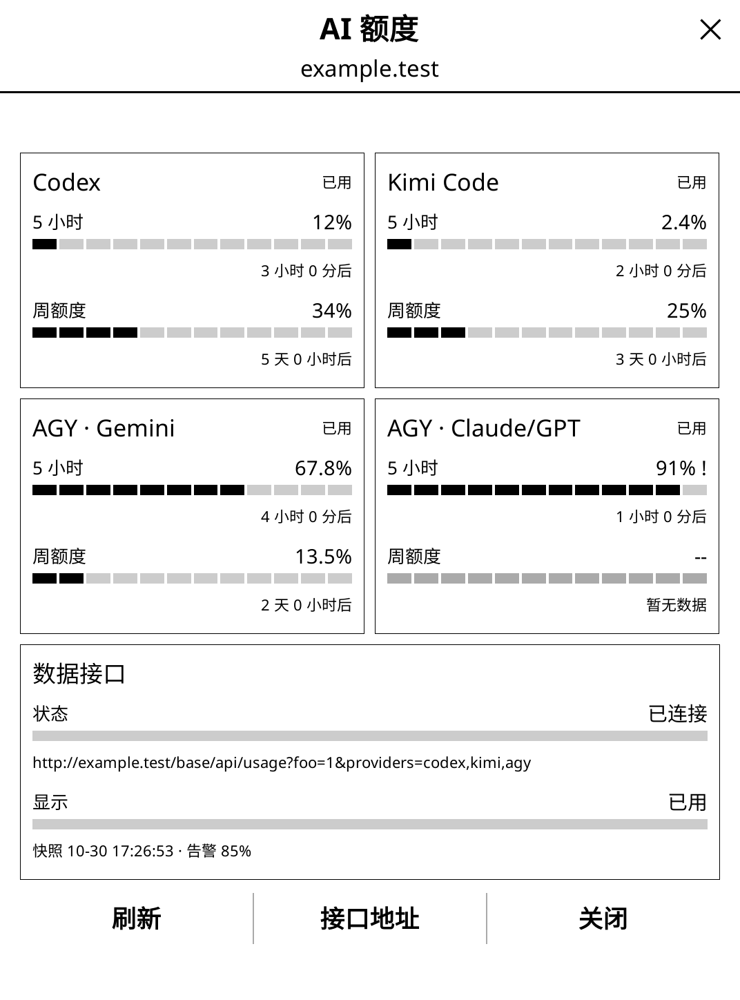

# AI credits dashboard for KOReader

*[简体中文](README.zh-CN.md)*

A compact, full-screen KOReader plugin that reads the aggregate Usage API and shows Codex, Kimi Code, and Antigravity (Gemini plus Claude/GPT) credits.

Four provider tiles and one full-width connection-status tile fit on a single page without scrolling or pagination. Each quota window shows its percentage, a segmented e-ink-friendly bar, and reset time.



The default request is:

```text
http://123.161.179.32:46927/api/usage?providers=codex,kimi,agy
```

Use **API address** on the page to change the server. Both a server base URL and a complete `/api/usage` URL are accepted; the provider filter is applied to every request. The setting is persisted in KOReader's `settings/readingquota.lua`.

Copy `readingquota.koplugin/` to the KOReader plugins directory, restart KOReader, and open **More tools → AI credits**. Keep the unauthenticated API on a trusted LAN only.

## Development

With KOReader installed at `/usr/lib/koreader` under WSL:

```sh
./dev.sh check
./dev.sh link
./dev.sh smoke
./dev.sh run
./dev.sh log
```

The smoke test renders loading, used, remaining, partial-data, and rebuild states with synthetic API data, so it does not require the LAN service to be online.
