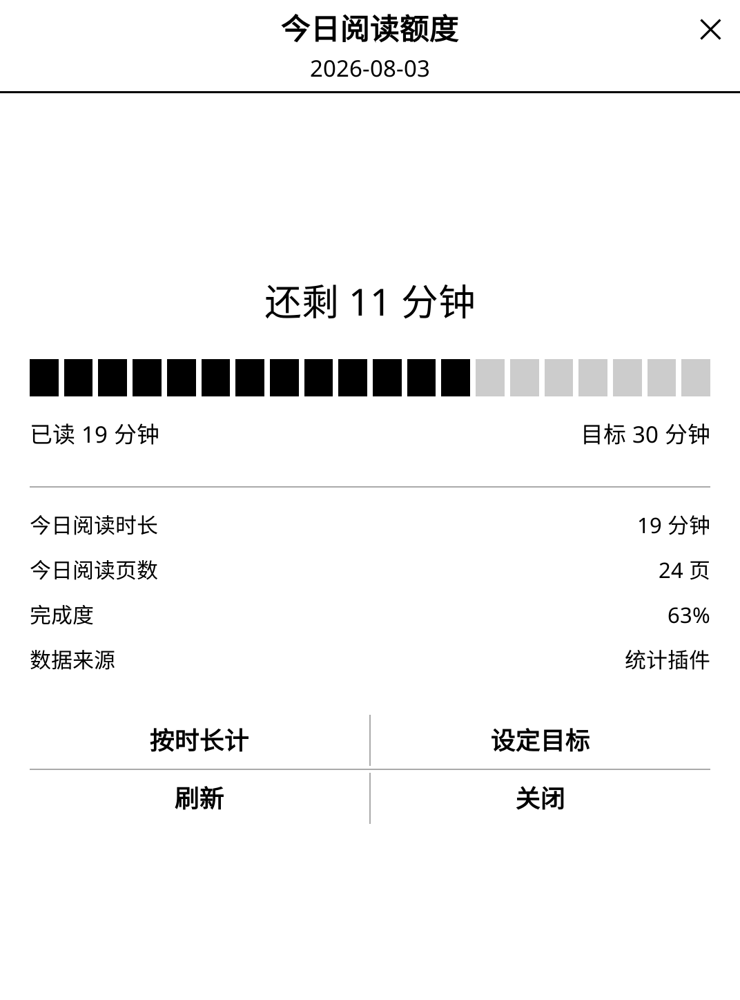

# readingquota.koplugin

*[English](README.md)*

一个 KOReader 插件：全屏显示「今日阅读额度」页面 —— 今天的阅读目标还剩多少，
用类似终端额度条的分段方块条来展示。



## 为什么用 KOReader 插件，而不是 KUAL 扩展

KUAL 是个**启动器**，不是 UI 框架 —— 它读 `menu.json`、执行 shell 脚本。在 KUAL
下面画界面得靠 `eips` 或 FBInk 直接操作 framebuffer，自己解析 `/dev/input`，手动
管理墨水屏的刷新模式，而且没法在设备之外测试。

KOReader 插件白拿 widget 库、手势处理、刷新策略，还有桌面模拟器，同一份代码在
Kindle、Kobo、Android、Linux 上原样跑。在 Kindle 上这两者甚至谈不上是替代关系：
KOReader 通常就是从 KUAL 里启动的，所以 KUAL 继续当启动器，KOReader 当运行时。

## 文件结构

| 文件 | 作用 |
| --- | --- |
| `_meta.lua` | 插件名和描述，KOReader 靠这个识别插件 |
| `main.lua` | `WidgetContainer`：菜单入口、dispatcher 动作、启动页面 |
| `quotapage.lua` | 全屏页面（`covers_fullscreen = true`） |
| `quotabar.lua` | 分段方块条 widget |
| `quotadata.lua` | 从统计数据库读取今日数字，加上目标设置 |

今日阅读时长和页数直接从 statistics 插件的 `statistics.sqlite3` 里读，不用重复
埋点。如果这个数据库不存在或 schema 变了，`quotadata.lua` 会退回示例数据，并在
「数据来源」那一行如实说明，而不是直接报错。

每日目标存在 `settings/readingquota.lua` 里，可以按分钟或按页数计，页面上有按钮
可以切换。

## 入口

- 文件管理器 / 阅读器菜单 → 更多工具 → 今日阅读额度
- 一个 dispatcher 动作（`Reading quota`），可以绑定到手势或按键

同时在文件管理器和阅读器里注册（`is_doc_only = false`），这样它才能作为一个独立
页面使用，而不只是阅读器的附属功能。

## 开发（WSL）

`dev.sh` 假设 KOReader 装在 `/usr/lib/koreader`（deb 包的布局），并且 `:0` 上有
可用的 X 显示。

```sh
./dev.sh check   # 用 KOReader 自带的 luajit 对每个 Lua 文件做语法检查
./dev.sh link    # 把插件软链接到 ~/.config/koreader/plugins
./dev.sh smoke   # 把每种页面状态渲染成 preview-*.png，不用点任何东西
./dev.sh run     # 启动模拟器
./dev.sh log     # 查看日志尾部
```

`smoke` 是最快的开发回路：它只启动构造页面并绘制所需的最小 KOReader 环境，然后
把结果画进 PNG，这样能抓到语法检查抓不到的运行时错误 —— 比如 widget 字段写错、
尺寸算出 nil、require 缺失。它会渲染真实数据，再加三种人为构造的状态（部分完
成、目标达成、按页数计）。

模拟器默认按 Kindle Paperwhite 的尺寸（1072×1448）启动；可以用
`EMULATE_READER_W` / `EMULATE_READER_H` 覆盖。

## 部署到 Kindle

把 `readingquota.koplugin/` 整个拷贝到 `/mnt/us/koreader/plugins/`。纯 Lua，不
需要交叉编译 —— 模拟器里跑的就是设备上跑的东西。KOReader 本身怎么落到
`/mnt/us/koreader/` 并从 KUAL 启动，参见
[Installation on Kindle devices](https://github.com/koreader/koreader/wiki/Installation-on-Kindle-devices)。

## 参考资料

### 先看这个

**官方没有插件开发指南。** wiki 上没有 `Plugin-Development` 这一页（打开是个空
白的"新建页面"表单），[Development_guide](https://koreader.rocks/doc/topics/Development_guide.md.html)
也只讲源码目录结构 —— 完全没提插件、kodev 或模拟器。实际可靠的资料来源按优先级
排是：本机安装的源码、自动生成的 API 参考、以及现有插件。

### 本机源码 —— 最权威

deb 安装包是最可信的参考，因为它就是这个插件实际运行的那个确切版本
（`/usr/lib/koreader/git-rev` → **v2026.07.1**）。`koreader.rocks/doc` 是从
master 分支生成的，可能会描述本地这个版本还没有的 API。

| 路径 | 里面是什么 |
| --- | --- |
| `/usr/lib/koreader/frontend/ui/widget/` | widget 库 —— 看每个文件开头的字段列表 |
| `/usr/lib/koreader/frontend/ui/elements/*_menu_order.lua` | 菜单树；能看懂 `sorting_hint` 会落在哪里 |
| `/usr/lib/koreader/plugins/hello.koplugin/` | 最小化插件模板 |
| `/usr/lib/koreader/plugins/statistics.koplugin/` | 本插件读取的数据库；SQL 和 schema 都在 `main.lua` 里 |
| `frontend/ui/widget/pagebrowserwidget.lua`、`bookstatuswidget.lua` | 全屏页面的写法范例（`covers_fullscreen`、按键事件、关闭处理） |

### API 参考文档

[koreader.rocks/doc](https://koreader.rocks/doc/) —— LDoc 自动生成，约 180 个
模块，跟随 master 分支重新生成。模块页面的地址规律是
`https://koreader.rocks/doc/modules/<module.path>.html`，比如
[ui.widget.progresswidget](https://koreader.rocks/doc/modules/ui.widget.progresswidget.html)。

值得一看的主题页面：

- [UI Events](https://koreader.rocks/doc/topics/Events.md.html) —— 事件如何在
  widget 层级里传播；加手势或自定义事件之前应该先看这个
- [DataStore](https://koreader.rocks/doc/topics/DataStore.md.html) —— 设置和
  数据目录
- [Hacking](https://koreader.rocks/doc/topics/Hacking.md.html)、
  [Unit tests](https://koreader.rocks/doc/topics/Unit_tests.md.html)、
  [Porting](https://koreader.rocks/doc/topics/Porting.md.html)

### 示例插件

[koreader/contrib](https://github.com/koreader/contrib) —— 官方维护的社区插件
合集。里面好几个是"app 型"而不是阅读器附属功能（计算器、日历、国际象棋、数独、
RSS 阅读器、网页浏览器），是"KOReader 里的独立 app"这个思路最接近的实例参考。

### 从源码构建

[doc/Building.md](https://github.com/koreader/koreader/blob/master/doc/Building.md)
—— `./kodev build` 和 `./kodev run`，用 `-w` / `-h` / `-d` 指定模拟器尺寸，还有
`kindle3` 这类设备预设。基于 deb 安装做开发用不上这个，但哪天要改 KOReader 本体
就得走这条路。

### Wiki

- [Wiki 首页](https://github.com/koreader/koreader/wiki)（wiki 自己提示部分页面
  内容可能过时）
- [User patches](https://github.com/koreader/koreader/wiki/User-patches) ——
  不 fork 源码也能改核心行为
- [KOReader Gestures](https://github.com/koreader/koreader/wiki/KOReader-Gestures)
  —— dispatcher 动作要绑定的手势系统
